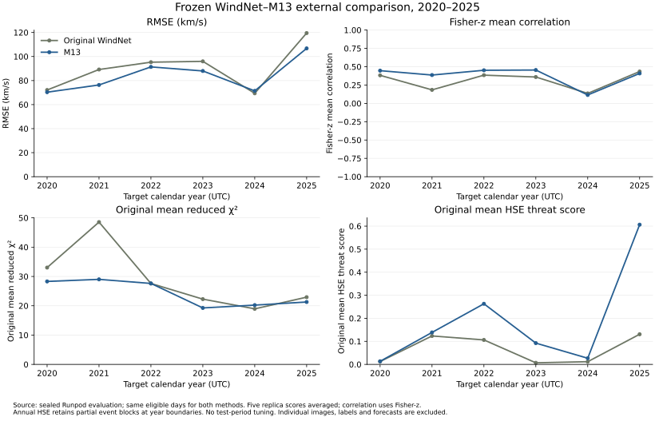
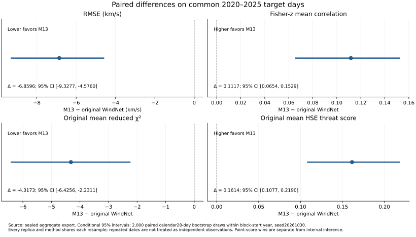

# Frozen original WindNet versus M13: external 2020–2025 comparison

M13 improved all four primary metrics numerically. The comparison used 1968 common target days. Both models were frozen before test access, and neither was tuned, refitted, recalibrated or selected using this period.

| Primary metric | Original WindNet | M13 | M13 − original | Paired 95% interval |
|---|---:|---:|---:|---:|
| RMSE (km/s), lower is better | 92.005640 | 85.146022 | -6.859618 | [-9.327742, -4.575994] |
| Fisher-z mean correlation, higher is better | 0.400173 | 0.511918 | 0.111745 | [0.065386, 0.152852] |
| Original mean reduced χ², lower is better | 28.380119 | 24.062824 | -4.317295 | [-6.425609, -2.231073] |
| Original HSE threat score, higher is better | 0.068724 | 0.230157 | 0.161433 | [0.107702, 0.218951] |

Each method has five existing historical replicas. RMSE, χ² and HSE scores are averaged across replicas; correlations are Fisher-z averaged. The repeated dates are not five independent test sets. The strict numerical all-four criterion and uncertainty are separate statements. The intervals are conditional on these frozen models and this period, using 2,000 paired resamples of fixed calendar 28-day units within block-start year, seed 20261030. They do not establish performance in a different solar cycle or adjust for every earlier development decision.

Calendar-year summaries were fixed before test access and were not used to change either method. Annual HSE preserves intersections of the original event blocks with each year, including partial boundary segments.

## Matched inputs and exclusions

Target dates were 2020-01-01 through 2025-12-31 UTC: 2192 requested days. The evaluator retained 141 of 157 fixed calendar 14-day event blocks and excluded 16 incomplete blocks for both models. The shared χ² mask contains 1968 positive finite daily-sigma values. Input-image exclusions by frozen reason: {'nonfinite_or_shape': 2, 'quality_flag': 12}.

Both methods receive the same 211 Å image dates t−6, t−5, t−4 and t−3. Images come from the definitive JSOC AIA synoptic archive, processed with the published SDOMLv1 SUM convention, the frozen 2017 version-8 AIA response table, and the author’s intensity transformation. The first available same-day image nearest midnight is selected; a failed quality flag does not trigger a search for a more favorable replacement. Calendar gaps are never compacted into neighboring HSE days. OMNI2 daily bulk speed and its daily sigma enter only the final scoring boundary. The sigma describes dispersion across hourly speeds.

## Freeze and verification

Original WindNet uses the actual author-retained TensorFlow checkpoints at epochs 60, 63, 108, 290 and 99. M13 loads the existing F3 trained artifacts and normalization. No model was retrained. Original image means and target scaling were reconstructed only from corresponding pre-2019 fitting folds. All five original-model reference checks passed with maximum forecast difference below 0.001 km/s. All 55 M13 artifact hashes were verified, and independent saved-recipe composition matched on pre-2019 examples. The reconstructed 2018 input image matched the released processed image to RMS 0.001782 on the 0–256 scale. This bridge is an implementation check, not external performance evidence. Individual F3 forecasts were not retained, so exact vector-by-vector cross-runtime reproduction of M13 cannot be claimed.

All ten external replica forecast arrays were completed and hashed before the target labels were opened. The evaluator rechecked scientific-source and model hashes after scoring. Individual external images, target labels, forecasts and residuals were not exported or inspected for hypothesis generation. This report uses only the aggregate export. The earlier adaptive improvement loop remains paused; no model is promoted from this external test.

This is a matched head-to-head comparison on a new period. Its absolute scores are not directly interchangeable with WindNet’s published 2011–2018 evaluation because the target days differ. The evaluation is retrospective, using definitive images; it does not establish real-time data availability.

## Reproducibility

- [Complete aggregate scores, calendar-year results and coverage](external_results.json)
- [Aggregate CSV](aggregate_comparison.csv)
- [Prediction lock](prediction_lock.json)
- [Model lock](model_lock.json)
- [Complete evaluator freeze](evaluator_freeze.json)
- [Exact source bytes](frozen_source_bundle.json)
- [Preprocessing and metric protocol](README.md)
- [RogNet experiment](https://fixrelay.vercel.app/experiments/a84303f5-6cff-4af4-9aab-225c96b8b499)
- [Dashboard](https://windnet-matched-research-loop.wellbat32.chatgpt.site/external.html)

Frozen source commit: `d12d1fca5b667a55d0c5da994a0d0ec3d92e71c6`. Evaluator freeze SHA-256: `4cf33024df2d83267eaa079bde36f639b481512949d2f66bc01b62b003875927`. Prediction archive SHA-256: `0f40df92ad36771ee5833cdd73caee8e448db69ec78b63c38d8b26327845b560`. The source snapshot was published before external execution. RogNet records this separate campaign privately because its connected tools cannot change public sharing; GitHub code and aggregate artifacts are public.
